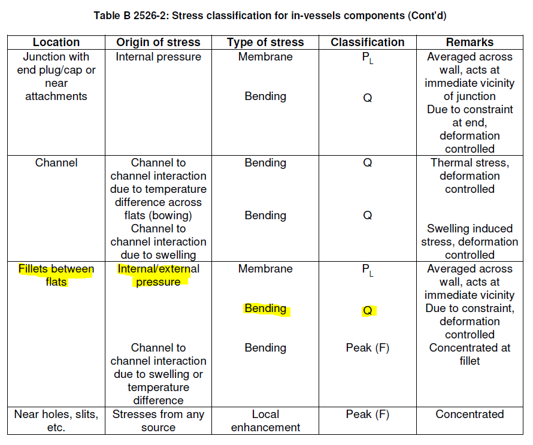

# Code interpretations

This section lists the key design code interpretations and implementation decisions that guided the CASSY assessments. It is meant to make explicit every point where the code text leaves room for choice, so that results can be reviewed against the design codes.

## Common to all codes

### Scope of the implemented rules
Only elastic analysis rules with negligible creep are implemented. Service levels A, C and D are supported. Rules that the codes do not require at a given level (e.g. ratcheting in level D) are skipped and do not appear in the results.

All stresses are converted to Pa internally, whatever the unit of the input files.

### Stress classification of single loads
Each single load is classified as a whole as either primary (P) or secondary (Q). The membrane, bending and peak parts of its linearized stress all go into the same category. The only exception is the SDC-IC [fillet path](#distinction-between-normal-and-fillet-paths) rule.

Inertial loads are always primary: CASSY refuses to classify an inertial load as secondary.

### Stress intensity
From path linearization we obtain 6 stress components: Sx, Sy, Sz, Sxy, Sxz, Syz.
Whenever the code requires a stress intensity, CASSY first combines all the tensors that make up that stress and then computes the intensity as a Von Mises stress. If inertial loads (i.e. loads without a sign) are present, the [upper limit formulation](FEM-theory.md#upper-limit-von-mises) of the Von Mises stress is used.

The tensors are combined as follows:

- volumetric loads are always summed algebraically;
- the X, Y and Z components of each inertial load are first recombined with the spatial recombination method chosen for that load (e.g. SRSS);
- different inertial loads are then combined with each other in SRSS.

### The local primary membrane stress intensity P_L

P_L, the local primary membrane stress, in CASSY is always interpreted as Pm, the primary membrane stress.

### Stress ranges and reference events
CASSY does not search for the maximum range between the instants of a transient. A reference event is the signed combination of load steps that the user defines, and every stress of the event (including the ranges ΔQ and Δσ used in ratcheting and fatigue) is the intensity of that combination. The user is therefore responsible for defining reference events whose load combination represents the range to assess (e.g. `+ step_hot - step_cold`).

### Path begin and end
Each path is assessed independently at its begin and end points. Each point gets its own verdict, design driver and fatigue usage fraction, and the two are never mixed.

### Material properties out of bounds
If a material property is requested outside the range where it is defined, CASSY does not extrapolate. Instead it invalidates the rule (or the fatigue event), counts it as FAILED and goes on with the rest of the assessment. An invalidated fatigue event is given $V_j = 10^5$.

## SDC-IC

### Effective bending shape factor
In rule IC 3121.1.1.2a, to compute Keff one should postulate a value of K, which in principle is a function of the shape. CASSY always assumes K=1.5 and computes Keff accordingly as

$$K_{eff} = 1 + 2(K - 1)(K_{eff,rec} - 1)$$

where $K_{eff,rec}$ is taken from the material data. If the material does not provide it, $K_{eff,rec} = 1.5$ is assumed, which gives $K_{eff} = 1.5$.

### Distinction between normal and fillet paths

In the classification between primary and secondary stresses, SDC-IC makes some distinctions on how to classify stresses depending on their source and on the geometry where the path is defined. In particular, it specifies that if a path is defined in a fillet, pressure-induced bending stresses should be considered secondary and not primary. Hereafter is an extract of the relevant SDC-IC section:

In CASSY this applies to loads flagged as pressure, classified as primary and evaluated on a path of type "fillet". Their bending component is moved from primary to secondary, while membrane and peak components stay primary.

### Immediate local fracture
In IC 3121.3.1, the total stress including peaks (P+Q+F) is compared with Sd and the total stress excluding peaks (P+Q) with Sd_nopeak. The allowables are multiplied by 1.2 in level C and 1.35 in level D. As prescribed for welded joints, Sd and Sd_nopeak are the base metal values: the joint efficiency n is not applied (it only enters IC 3121.1.1, through Sm).

### Plasma disruption derived stresses
This distinction applies to the 3Sm rule (ratcheting) in SDC-IC.
The rule is defined as
$$\mathrm{Max}\left(\overline{P_L + P_b}\right) + \Delta\left[\overline{P} + \overline{Q}\right]_{\max} \leq 3S_m(T_m, \Phi t_m)$$

Here, the code specifies that $\mathrm{Max}\left(\overline{P_L + P_b}\right)$ should not include plasma disruption derived loads, which instead need to be accounted for in the cyclic primary part of the equation.

### Efficiency index in ratcheting
For the efficiency index diagram (IC 3131.1.1) the code foresees two routes depending on whether secondary membrane stresses are present. Since thermal stresses will always be present in in-vessel components, the route with secondary membrane stress is the only one implemented in CASSY.

At this point the rules split again in case of "overstress of short duration". Depending on whether any of the loads have been flagged as short duration, one or the other path is followed. The short-duration overstress is also added to the secondary stress range when computing the secondary ratio.

The efficiency index is used as a second chance for the 3Sm rule:

- it is evaluated only if the 3Sm rule fails;
- the ratcheting assessment is passed if either the 3Sm rule or both efficiency index equations are satisfied;
- the side that does not govern is reported as "superseded" and not used for the verdict.

The elasto-plastic stresses $\sigma_{nm}$ and $\sigma_{nmb}$ are obtained with Neuber's rule (Kf = 1) on the monotonic minimum true stress-strain curve. The tangent moduli needed for the short-duration route are derived from the same curve. If the curve is not available, or the stress falls outside it, the efficiency index is not computed and only the 3Sm result is reported.

The Bree diagram rule (IC 3131.1.2) is not implemented.

### Fatigue
In IC 3132.3.1 the total stress range is the intensity of the full reference event including peaks (P+Q+F), multiplied by the welding factor f.

- **Strain-based fatigue curves**: the total strain range is $\Delta\varepsilon_1 + \Delta\varepsilon_2 + \Delta\varepsilon_3 + \Delta\varepsilon_4$. $\Delta\varepsilon_2$ is computed from the cyclic primary stresses, as $P_m + 0.67\,P_b$ of the primary loads flagged as cyclic. If the material has no cyclic stress-strain curve, $\Delta\varepsilon_2 = 0$ is assumed.
- **Stress-based fatigue curves**: the curve is entered with the stress amplitude, half the total stress range, and no plasticity or mean stress correction is applied.

## RCC-MR

### Primary stress limits
In RB 3251.11, Pm is compared with n·Sm and Pm+Pb with 1.5 times the same allowable (i.e. a shape factor of 1.5 is always assumed). The allowables are evaluated on unirradiated properties (dpa = 0), whatever the dpa of the reference event.

### Progressive deformation
In RB 3261.116, the 3Sm rule is computed as Pm+Pb of all primary loads plus the secondary stress range ΔQ. No plasma disruption distinction is made. The efficiency index equations are computed as in [SDC-IC](#efficiency-index-in-ratcheting). The rule is checked in level A only.

### Fatigue
In RB 3261.123 only strain-based fatigue curves are supported. The strain range is computed as in [SDC-IC](#fatigue).

## RCC-MRx

### Primary stress limits
RB 3251.112 is implemented as RCC-MR RB 3251.11, but the allowables use the dpa of the reference event.

### Progressive deformation
In RB 3261.111 only the 3Sm rule (Pm+Pb plus ΔQ) is implemented. The efficiency index is not evaluated. The rule is checked in level A only.

### Fatigue
In RB 3261.1123 only strain-based fatigue curves are supported. The strain range is computed as in SDC-IC, except that, creep being negligible, $\Delta\varepsilon_3$ is derived assuming $\Delta\varepsilon_i = 0$:

$$\Delta\varepsilon_3 = K_\varepsilon \sqrt{\Delta\varepsilon_1 (\Delta\varepsilon_1 + \Delta\varepsilon_2)} - \Delta\varepsilon_1 - \Delta\varepsilon_2$$

## Bolts

### Actions on the bolt
The bolt axis is always the local z axis of the actions. The resultant actions used in the rules are:

- axial force $N = |F_z|$: a compressive axial force is assessed as if it were tensile;
- bending moment $M = \sqrt{M_x^2 + M_y^2}$;
- transverse force $T = \sqrt{F_x^2 + F_y^2}$.

The torsional moment $M_z$ coming from the FE actions is not used. The only torsion considered is the residual twisting torque from the preload ($C_r$ in the threads and $C_t$ under the head), which is included only in the "all loads" maximum stress and head shear stress.

The preload is not added by CASSY to the actions. If it has to be part of the "all loads" combination, the FE actions of that combination must already include it.

### Applicable stresses
The stresses are computed following SDC-IC B 3812.2.6, for all codes:

- the bending stress uses the section modulus of the thread root section;
- the mean stress includes the shear from the transverse load, $\sqrt{\sigma_N^2 + 3\tau_T^2}$;
- the maximum stress adds bending, $\sqrt{(\sigma_N + \sigma_M)^2 + 3\tau_T^2}$, and, for all loads, the residual twisting torque, $\sqrt{(\sigma_N + \sigma_M)^2 + 3(\tau_T + \tau_{Cr})^2}$.

For inserts, only the shear stress and contact pressure in the threads of the base material are assessed. Head and washer stresses are not computed.

### SDC-IC

#### Goodman's correction in bolts

For bolt materials that provide stress-based curves instead of strain-based curves, the application of the code is tricky. The reasons are summarized in the slides that can be found in [ITER IDM](https://user.iter.org/default.aspx?uid=4ZUD2K).

In IC 6131.2.1, the nominal stress range is first corrected for stress concentration and plasticity with Neuber's rule (KF on the cyclic stress-strain curve). If the cyclic curve is not available, the range is simply multiplied by KF. Goodman's correction then gives the equivalent range at zero mean stress:

$$\overline{\Delta\sigma} = \frac{\Delta\sigma}{1 - \sigma_m / S_u}, \qquad \sigma_m = \min(S_y, K_F\,\sigma_{pre})$$

When the material fatigue curves are provided with a dependence on the mean stress, it is assumed that no further mean stress correction is needed. Hence, Goodman's correction is not applied, and the curve is entered with the amplitude $\Delta\sigma/2$, using $\sigma_{pre}$ as mean stress. The first curve whose mean stress is not lower than $\sigma_{pre}$ is used; above the highest mean stress available, the last curve is used.

### RCC-MRx

#### Strength threshold
RB 3284 gives different limits in level C (and D) depending on the minimum tensile strength of the bolt material. CASSY uses $S_u = 700$ MPa, evaluated at the reference event temperature and dpa, as the threshold.

#### Base material threads
For the threads in the base material (inserts), the shear stress for primary loads is limited by 0.3·Sm of the base material, instead of the bolting allowable Smb.

#### Fatigue
In RB 3261.112 the total stress range is KF times the nominal stress intensity range, and the strain range is computed as for the RCC-MRx paths. No mean stress correction (Goodman or other) is applied. Stress-based fatigue curves are not foreseen by RCC-MRx: they are accepted with a warning and used as in SDC-IC, but without any correction.

For Inconel bolts, the RCC-MRx fatigue curve is chosen by comparing the stress range with 2.7·Sm and 2.7·Smb (and 3·Sm, 3·Smb). Above 3·Sm and 3·Smb, no curve is available and the event is invalidated.

### EN 13445

Only fatigue is assessed with EN 13445 (Part 3, 18.12). The immediate damage rules are not implemented. The following choices are made:

- the minimum tensile strength $R_m$ is capped at 785 MPa;
- the size factor is applied for bolt diameters larger than 25 mm;
- in the temperature correction factor $f_t^*$, the minimum cycle temperature is conservatively assumed to be 25 °C;
- the stress concentration factor KF of the bolt is not applied to the stress range;
- below the endurance threshold ($\Delta\sigma / R_m < 0.0522$), the allowable number of cycles is conservatively set to $N = 2 \cdot 10^6$ instead of infinite.
